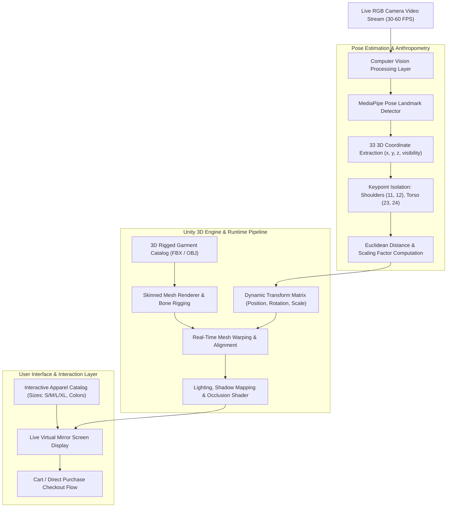

<div align="center">

<!-- Header Banner -->


<p align="center">
  
  
  
  
  
</p>

<p align="center">
  <a href="#-abstract--project-overview">Abstract</a> •
  <a href="#-core-engineering-innovations">Key Innovations</a> •
  <a href="#-system-architecture--pipeline">Architecture</a> •
  <a href="#-pose-tracking--mesh-alignment-mathematics">Tracking Mathematics</a> •
  <a href="#-hardware-performance--experimental-results">Performance Benchmarks</a> •
  <a href="#-repository-structure--thesis-access">Repository Structure</a> •
  <a href="#-authors--academic-affiliation">Authors & Affiliation</a>
</p>

</div>

---

### 📖 Abstract & Project Overview

The exponential expansion of digital e-commerce has transformed consumer apparel shopping; however, the inability to physically inspect garment drape, sizing, and aesthetic compatibility remains the primary driver of customer hesitation and reverse logistics costs. Online apparel return rates routinely surpass **30% to 40%**, causing severe profitability drains for retailers and substantial carbon packaging emissions globally.

The **Augmented Reality-Based Clothing Trial App** delivers a markerless, real-time **Virtual Fitting Room (VFR)** operating on standard consumer RGB mobile cameras without requiring costly LiDAR sensors or specialized hardware depth scanners. Developed as a **Senior Design Capstone Project** in the **Department of Electrical and Computer Engineering at North South University**, the platform combines **MediaPipe 33-point 3D skeletal landmark tracking** with the **Unity 3D rendering engine**. The system calculates dynamic anthropometric shoulder-to-hip proportions, adjusts non-rigid 3D garment meshes in real time, and renders photorealistic clothing drape at up to **60 FPS**.

---

### 🌟 Core Engineering Innovations

- **Markerless 33-Keypoint Skeletal Tracking:** Leverages Google's MediaPipe Pose pipeline to track sub-millimeter 3D spatial landmarks across the acromion (shoulders), sternum, spine, hips, and limbs in real time.
- **Dynamic Anthropometric Scaling:** Continuously recalculates user torso dimensions, automatically warping and scaling 3D garment models to match individual body types.
- **Real-Time Cloth Physics & Draping:** Implements Unity-powered skinned mesh renderers with real-time collision detection, ensuring garments drape and flex naturally with user motion.
- **Foreground Occlusion Reasoning:** Resolves depth-buffer occlusion anomalies, ensuring arms, hands, and accessories render naturally in front of or behind virtual garments.
- **Cross-Platform RGB Operability:** Achieves real-time virtual try-on on everyday iOS/Android smartphones and PC webcams without depth cameras or dedicated infrared rigs.
- **Environmental & E-Commerce Impact:** Designed directly to curtail reverse logistics return rates, minimizing packaging waste, shipping fuel burn, and textile waste.

---

### 🧠 System Architecture & Pipeline



---

### 📐 Pose Tracking & Mesh Alignment Mathematics

To ensure virtual apparel scales synchronously with user movements and varying camera distances, the system computes Euclidean spatial distances across pivotal anatomical landmarks:

#### 1. Shoulder Span & Torso Metric
Given right acromion landmark $L_{12}(x_{12}, y_{12}, z_{12})$ and left acromion landmark $L_{11}(x_{11}, y_{11}, z_{11})$:
$$D_{\text{shoulder}} = \sqrt{(x_{12} - x_{11})^2 + (y_{12} - y_{11})^2 + (z_{12} - z_{11})^2}$$

Torso height is calculated between the mid-point of the shoulders $M_{\text{shoulder}}$ and the mid-point of the hips $M_{\text{hip}}$:
$$M_{\text{shoulder}} = \frac{L_{11} + L_{12}}{2}, \quad M_{\text{hip}} = \frac{L_{23} + L_{24}}{2}$$
$$H_{\text{torso}} = \| M_{\text{shoulder}} - M_{\text{hip}} \|_2$$

#### 2. Dynamic Scale Transformation Matrix
The 3D garment mesh transformation matrix $T_{\text{garment}}$ is continuously updated in Unity:
$$S_x = \alpha \cdot D_{\text{shoulder}}, \quad S_y = \beta \cdot H_{\text{torso}}, \quad S_z = \gamma \cdot \frac{S_x + S_y}{2}$$
$$\theta_{\text{roll}} = \arctan2(y_{12} - y_{11}, x_{12} - x_{11})$$

Where $\alpha, \beta, \gamma$ are calibrated sizing scalars matching garment sizing specs (S, M, L, XL).

---

### 📊 Hardware Performance & Experimental Results

Controlled empirical trials evaluated tracking accuracy, frame rates, and latency across diverse mobile device tiers with **20 participants (10 male, 10 female)**:

#### 1. Performance Across Mobile Devices (Empirical Benchmark)

| Hardware Device Tier | Operating Frame Rate | End-to-End Latency | Skeletal Tracking Accuracy |
| :--- | :---: | :---: | :---: |
| **High-End Smartphone** (Flagship Chipset) | **60 FPS** | **50 ms** | **95.0%** |
| **Mid-Range Smartphone** | **45 FPS** | **100 ms** | **92.0%** |
| **Budget / Low-End Smartphone** | **30 FPS** | **200 ms** | **88.0%** |

#### 2. Environmental Lighting Sensitivity
- **Optimal Ambient Lighting:** **96.0%** tracking accuracy.
- **Sub-optimal / Low-light Conditions:** **84.0%** tracking accuracy (maintains tracking stability through temporal landmark smoothing).

#### 3. User Satisfaction Evaluation (Out of 5.0)

| Usability Metric | User Rating Score |
| :--- | :---: |
| **Visual Realism & Drape** | ⭐ **4.8 / 5.0** |
| **Overall Experience Satisfaction** | ⭐ **4.7 / 5.0** |
| **System Usability & Flow** | ⭐ **4.6 / 5.0** |
| **Garment Interaction & Switch Speed** | ⭐ **4.5 / 5.0** |

---

### 📁 Repository Structure & Thesis Access

```
├── Augmented-Reality-Based-Clothing-Trial-App-blackbook.docx   # Complete 100KB Senior Design Thesis Blackbook
├── Augmented_Reality_Based_Clothes_Trial_App_or_Model-1.pdf     # Full 428KB Academic Project Report
├── LICENSE                                                     # Open-source Apache-2.0 License
└── README.md                                                   # Project documentation & engineering specs
```

Full academic thesis documents, technical block diagrams, and literature reviews are accessible directly in this repository:
- 📄 **[Augmented-Reality-Based-Clothing-Trial-App-blackbook.docx](Augmented-Reality-Based-Clothing-Trial-App-blackbook.docx)**
- 📕 **[Augmented_Reality_Based_Clothes_Trial_App_or_Model-1.pdf](Augmented_Reality_Based_Clothes_Trial_App_or_Model-1.pdf)**

---

### 👥 Authors & Academic Affiliation

This project was developed as a **Senior Design Capstone Project** in the **Department of Electrical and Computer Engineering (ECE)** at **North South University (NSU)**, Dhaka, Bangladesh.

- **Readuanul Farid Fahim** (ID: 2021748642) — *ECE Department, North South University*
- **Saif Bhuiya** (ID: 2031296042) — *ECE Department, North South University*
- **Nusrat Zahan** (ID: 2013942642) — *ECE Department, North South University*
- **MD. Shariful Islam Sakib** (ID: 2011716042) — *ECE Department, North South University*
- **Fatema Nazneen Zeba** (ID: 1520381042) — *ECE Department, North South University*

**Faculty Advisor:**
- **Mr. Abu Obaidah (AbO)**, Lecturer, Department of Electrical & Computer Engineering, North South University

**Department Chairman:**
- **Dr. Mohammad Abdul Matin**, Professor & Chairman, Department of Electrical & Computer Engineering, North South University

---

### 📜 BibTeX Citation

```bibtex
@techreport{fahim2024arclothing,
  title       = {Augmented Reality-Based Clothing Trial App: Real-Time Virtual Fitting Room with Deep Pose Estimation},
  author      = {Fahim, Readuanul Farid and Bhuiya, Saif and Zahan, Nusrat and Sakib, MD. Shariful Islam and Zeba, Fatema Nazneen},
  institution = {North South University, Department of Electrical and Computer Engineering},
  address     = {Dhaka, Bangladesh},
  year        = {2024},
  month       = {August},
  type        = {Senior Design Project Report}
}
```

---

<div align="center">


</div>
