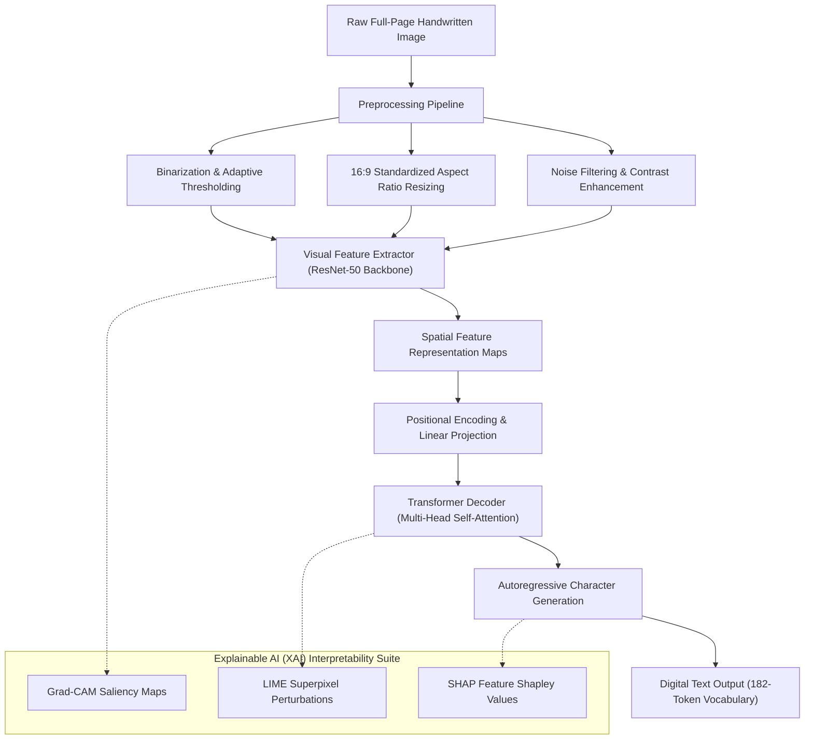

<div align="center">

<!-- Header Banner -->


<p align="center">
  
  
  
  
</p>

<p align="center">
  <a href="#-abstract--executive-summary">Abstract</a> •
  <a href="#-key-scientific-contributions">Key Contributions</a> •
  <a href="#-system-architecture">System Architecture</a> •
  <a href="#-explainable-ai-xai-framework">Explainable AI (XAI)</a> •
  <a href="#-dataset--augmentation-engineering">Dataset & Pipeline</a> •
  <a href="#-experimental-results--evaluation">Experimental Results</a> •
  <a href="#-citation--authors">Citation & Authors</a>
</p>

</div>

---

### 📖 Abstract & Executive Summary

Offline handwritten text recognition for the **Bangla (Bengali)** language presents severe computational challenges due to complex cursive ligatures (*juktakkhor*), varying stroke styles, extensive character inventories, matra (horizontal headlines), and overlapping spatial layouts. Traditional OCR pipelines rely heavily on multi-stage line, word, and character segmentation—an error-prone cascade where early segmentation failures permanently corrupt downstream recognition.

This directed research project presents an **end-to-end, segmentation-free full-page handwritten Bangla OCR architecture** coupled with an **Explainable AI (XAI)** interpretability framework. By combining a **ResNet-50 visual feature extractor** with a **Transformer Decoder**, the network transcribes entire unconstrained pages directly into digital text while preserving paragraph structures, margins, and document flow. To overcome the deep "black-box" dilemma of neural OCR, the system integrates **Grad-CAM**, **LIME**, and **SHAP** to quantitatively trace spatial attention, stroke saliency, and character prediction confidence.

---

### 🌟 Key Scientific Contributions

- **Segmentation-Free Full-Page Recognition:** Eliminates fragile line/word bounding-box slicing by processing full-page handwritten document images in a single end-to-end forward pass.
- **Hybrid Vision-Language Architecture:** Employs a deep convolutional backbone (**ResNet-50**) to extract spatial grapheme features and an autoregressive **Transformer Decoder** to capture long-range contextual character dependencies.
- **Layout & Structure Preservation:** Retains document-level formatting (paragraph breaks, scratch/deletion markers, and bilingual English-Bangla switching) using a specialized 182-token vocabulary.
- **Tri-Fold Explainability (XAI):** 
  - **Grad-CAM:** Generates class-activation coarse localization maps highlighting decisive stroke regions.
  - **LIME:** Perturbs superpixel segments to measure local boundary contributions.
  - **SHAP:** Computes game-theoretic Shapley values to identify critical pixel clusters.
- **Empirical Bongabdo & CMATERdb Benchmarks:** Formulated on the **Bongabdo** dataset (111 original full-page manuscripts from 49 demographic contributors) enriched via 12-fold geometric and photometric augmentations to **3,393 standardized training pages**.

---

### 🧠 System Architecture



---

### 🔍 Explainable AI (XAI) Framework

To diagnose OCR errors, build trust, and analyze morphological misclassifications in complex Bangla characters, the architecture incorporates three complementary interpretability paradigms:

#### 1. Grad-CAM (Gradient-Weighted Class Activation Mapping)
Computes gradients of the target class score $y^c$ with respect to feature activation maps $A^k$ of the final convolutional layer:
$$\alpha_k^c = \frac{1}{Z} \sum_{i} \sum_{j} \frac{\partial y^c}{\partial A_{ij}^k}$$
$$L_{\text{Grad-CAM}}^c = \text{ReLU}\left(\sum_{k} \alpha_k^c A^k\right)$$
- Identifies whether the neural network attends to top horizontal *matra* bars, distinctive vertical stems, or character loops.

#### 2. LIME (Local Interpretable Model-Agnostic Explanations)
Constructs locally faithful surrogate models around individual image predictions by segmenting character boundaries into interpretable superpixels and evaluating perturbation shifts:
$$\xi(x) = \arg\min_{g \in G} \mathcal{L}(f, g, \pi_x) + \Omega(g)$$
- Isolates ambiguous handwriting strokes and reveals why lookalike characters (such as ব vs. ক vs. র) trigger misclassifications.

#### 3. SHAP (SHapley Additive exPlanations)
Assigns additive feature importance values across input pixel subsets based on cooperative game theory:
$$\phi_i = \sum_{S \subseteq F \setminus \{i\}} \frac{|S|!(|F| - |S| - 1)!}{|F|!} \left[ f(S \cup \{i\}) - f(S) \right]$$
- Quantifies the marginal impact of background artifacts, paper texture, and ink bleed versus genuine handwritten ink.

---

### 📊 Dataset & Augmentation Engineering

The research utilized authentic multi-writer handwritten pages curated to reflect real-world demographic and typographical variability:

| Metric / Parameter | Value / Detail |
| :--- | :--- |
| **Primary Dataset** | **Bongabdo Dataset** (Character-level annotated full pages) |
| **Secondary Benchmark** | **CMATERdb** & **BanglaWriting** Integration |
| **Unique Contributors** | 49 writers (Diverse across age, gender, occupation, and style) |
| **Original Scanned Pages** | 111 full-page authentic manuscripts |
| **Augmentation Techniques** | 12 transformations (Rotation $\pm 15^\circ$, contrast scaling, elastic deformation, brightness adjustments) |
| **Final Augmented Corpus** | **3,393 processed high-resolution document pages** |
| **Vocabulary Size** | **182 unique tokens** (Bangla vowels, consonants, ligatures, punctuation, paragraph tags, scratch tokens) |

---

### 📈 Experimental Results & Performance

- **Model Training & Loss Dynamics:** Trained using Cross-Entropy Loss for autoregressive character classification with Adam optimizer and cosine learning rate decay, converging smoothly with tight train-validation loss margins.
- **Error Rate Metrics:**
  - **Character Error Rate (CER):** $\approx 40\%$ on unconstrained, multi-writer, unsegmented full-page manuscripts.
  - **Word Error Rate (WER):** $\approx 50\%$ without external language-model spell-checking or dictionary constraint.
- **Layout Retention:** Accurately reproduces paragraph splits, margin indentations, and strikethrough/scratched text tokens without requiring prior layout decomposition.

---

### 📁 Repository Structure

```
├── Directed Research.docx       # Full 56,000+ word academic research thesis document
├── LICENSE                      # Open-source license (Apache-2.0)
└── README.md                    # Project documentation, architecture & research summary
```

The comprehensive academic paper detailing literature reviews, mathematical models, confusion matrices, and training curves is available directly in this repository:
📄 **[Directed Research.docx](Directed%20Research.docx)**

---

### 👥 Authors & Academic Affiliation

This project was developed as a **Directed Research Project** in the **Department of Electrical and Computer Engineering (ECE)** at **North South University (NSU)**, Dhaka, Bangladesh.

- **Readuanul Farid Fahim** (ID: 2021748642) — *ECE Department, North South University*
- **Kousique Ahmmed** (ID: 2021752042) — *ECE Department, North South University*
- **Md Hasanul Haque Rumman** (ID: 2021753042) — *ECE Department, North South University*
- **Tanvir Mehtab** (ID: 1812079042) — *ECE Department, North South University*

**Faculty Advisor:**
- **Rifat Ahmed Hassan**, Lecturer, Department of Electrical & Computer Engineering, North South University

**Department Chairman:**
- **Dr. Mohammad Abdul Matin**, Professor & Chairman, Department of Electrical & Computer Engineering, North South University

---

### 📜 BibTeX Citation

```bibtex
@techreport{fahim2025banglaocr,
  title       = {Bangla Handwritten Text Conversion Using Optical Character Recognition with Explainable AI Architecture},
  author      = {Fahim, Readuanul Farid and Ahmmed, Kousique and Rumman, Md Hasanul Haque and Mehtab, Tanvir},
  institution = {North South University, Department of Electrical and Computer Engineering},
  address     = {Dhaka, Bangladesh},
  year        = {2025},
  month       = {January},
  type        = {Directed Research Report}
}
```

---

<div align="center">


</div>
