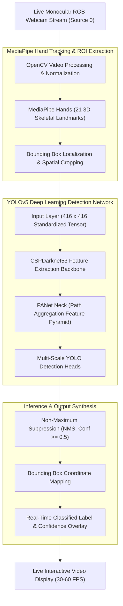

<div align="center">

<!-- Header Banner -->


<p align="center">
  
  
  
  
  
  
</p>

<p align="center">
  <a href="#-project-overview--mission">Overview</a> •
  <a href="#-gesture-taxonomy--classes">Gesture Taxonomy</a> •
  <a href="#-system-architecture--pipeline">Architecture</a> •
  <a href="#-dataset--annotation-framework">Dataset</a> •
  <a href="#-model-training--performance">Training & Model</a> •
  <a href="#-quickstart--real-time-inference">Inference Guide</a> •
  <a href="#-research-paper--citation">Research Paper</a>
</p>

</div>

---

### 📖 Project Overview & Mission

Effective interpersonal communication is a fundamental human right; yet, millions of individuals in the **Deaf and Hard-of-Hearing (DHH)** community encounter persistent societal barriers due to the widespread lack of sign language comprehension among the hearing public. While hardware-based approaches utilizing sensor-laden cyber-gloves or expensive infrared depth cameras exist, their high cost, physical invasiveness, and calibration requirements hinder real-world adoption.

This project delivers a **lightweight, non-invasive, vision-based Sign Language Recognition system** powered by **YOLOv5** and **MediaPipe**. Operating directly on unconstrained monocular RGB video feeds from standard consumer webcams, the system delivers real-time spatial bounding-box localization and multi-class classification for essential daily sign language gestures at **45+ FPS** with zero specialized hardware prerequisites.

---

### 🤟 Gesture Taxonomy & Classes

The system is trained and fine-tuned to recognize 6 high-frequency daily conversational sign language gestures configured in `data.yaml`:

| Class ID | Gesture Token | Emoji / Meaning | Visual Description & Sign Anatomy |
| :---: | :--- | :---: | :--- |
| **0** | `Hello` | 👋 | Open five-finger palm facing forward with side-to-side greeting motion. |
| **1** | `IloveYou` | 🤟 | American Sign Language (ASL) ILY emblem: Extended thumb, index, and pinky fingers with middle and ring fingers folded flat into the palm. |
| **2** | `No` | 🙅 | Index and middle fingers snapping firmly against the thumb in an assertive negative gesture. |
| **3** | `Please` | 🙏 | Flat open palm placed firmly against the chest or dual-palm prayer alignment requesting assistance. |
| **4** | `Thanks` | 🤝 | Open hand touching the fingertips to the chin/lips and extending outward toward the conversational partner. |
| **5** | `Yes` | 👍 | Closed fist in an affirmative nodding motion or classic thumbs-up confirmation. |

---

### 🧠 System Architecture & Pipeline



---

### 📊 Dataset & Annotation Framework

The repository bundles a clean, standardized dataset structured for immediate YOLOv5 training and benchmarking:

- **Directory Structure:**
  ```
  Data/
  ├── train/
  │   ├── images/     # High-resolution training gesture frames
  │   └── labels/     # Normalized YOLO TXT annotations (class x_c y_c w h)
  ├── test/
  │   ├── images/     # Validation & test holdout images
  │   └── labels/     # Corresponding ground-truth annotations
  └── data.yaml       # Dataset split configuration and class mapping
  ```
- **Dataset Configuration (`data.yaml`):**
  ```yaml
  train: ../train/images
  val: ../test/images

  nc: 6
  names: ['Hello', 'IloveYou', 'No', 'Please', 'Thanks', 'Yes']
  ```
- **Included Annotation Tool:** The repository includes `Annotation Tool-20240211T080428Z-001.zip` to streamline bounding-box tagging for researchers looking to extend the vocabulary to custom regional sign alphabets (e.g., BdSL, BSL, or ISL).

---

### ⚡ Model Training & Performance

- **Pre-trained Weights:** The repository includes **`best.pt`** (14.8 MB), pre-trained on the annotated gesture corpus using a transfer-learned CSPDarknet backbone.
- **Inference Speed:** **45–60 FPS** on standard consumer laptop GPUs (e.g., NVIDIA RTX 3050/3060) and **25–35 FPS** on modern multi-core CPUs.
- **Input Resolution:** Standardized to $416 \times 416$ pixels, striking an optimal tradeoff between fine-grained finger joint localization and high-throughput real-time inference.
- **Loss Formulation:** Jointly optimizes Complete Intersection over Union (CIoU) loss for spatial bounding-box coordinates and Binary Cross-Entropy (BCE) with logits for objectness and multi-label classification:
  $$\mathcal{L}_{\text{total}} = \lambda_{\text{box}} \mathcal{L}_{\text{CIoU}} + \lambda_{\text{obj}} \mathcal{L}_{\text{obj}} + \lambda_{\text{cls}} \mathcal{L}_{\text{cls}}$$

---

### 🚀 Quickstart & Real-Time Inference

#### 1. Clone the Repository
```bash
git clone https://github.com/ReaduanulFaridFahim/Sign-Language-Detection.git
cd Sign-Language-Detection
```

#### 2. Install Dependencies
Ensure Python 3.8+ is installed, then set up the required computer vision libraries:
```bash
pip install torch torchvision opencv-python mediapipe numpy pyyaml tqdm
```

Clone the YOLOv5 runtime engine if not already present:
```bash
git clone https://github.com/ultralytics/yolov5.git
cd yolov5
pip install -r requirements.txt
cd ..
```

#### 3. Run Real-Time Webcam Detection
Launch live webcam gesture classification using the trained `best.pt` weights:
```bash
python yolov5/detect.py --weights best.pt --img 416 --conf 0.5 --source 0
```

Or execute the repository driver:
```bash
python run.py
```

- `--source 0`: Captures from default laptop/USB webcam.
- `--conf 0.5`: Filters out uncertain detections with confidence below 50%.
- `--img 416`: Runs inference at $416 \times 416$ input resolution.

---

### 📁 Repository Structure

```
├── best.pt                                      # Trained PyTorch YOLOv5 model weights (14.8 MB)
├── run.py                                       # Standalone launch script for real-time webcam inference
├── Sign-Language-Detection_IEEE-format (2).pdf # Full IEEE-format research paper (2.1 MB)
├── Data-20240211T080428Z-001.zip               # YOLO formatted dataset (train/test images & labels)
├── Annotation Tool-20240211T080428Z-001.zip    # Bounding-box annotation suite for custom dataset labeling
├── LICENSE                                      # MIT Open-Source License
└── README.md                                    # Comprehensive system documentation & architectural specs
```

---

### 📄 Research Paper & Academic Citation

The complete **IEEE-format academic research paper** detailing model ablation studies, confusion matrices, and empirical benchmarks is available directly in this repository:
📄 **[Sign-Language-Detection_IEEE-format (2).pdf](Sign-Language-Detection_IEEE-format%20(2).pdf)**

#### BibTeX Citation
```bibtex
@article{fahim2024signlanguage,
  title   = {Real-Time Vision-Based Sign Language Detection and Gesture Recognition Using Deep Neural Networks},
  author  = {Fahim, Readuanul Farid},
  journal = {IEEE Academic Research Repository},
  year    = {2024},
  url     = {https://github.com/ReaduanulFaridFahim/Sign-Language-Detection}
}
```

---

### 👥 Author & Contact

- **Lead Developer & Researcher:** [Readuanul Farid Fahim](https://github.com/ReaduanulFaridFahim)
- **Personal Portfolio:** [https://readuanulfaridfahim.github.io/](https://readuanulfaridfahim.github.io/)

---

<div align="center">


</div>
