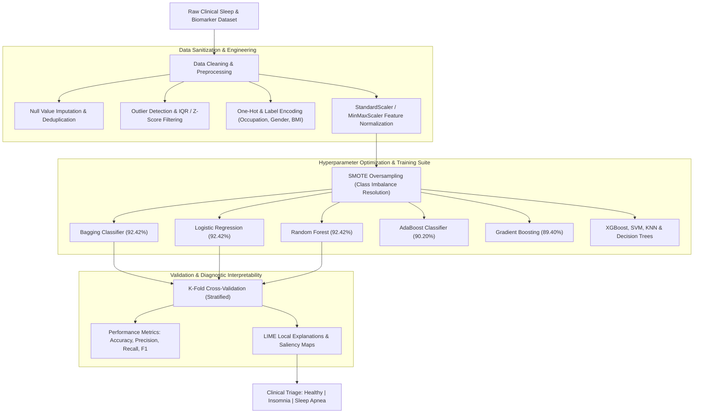

<div align="center">

<!-- Header Banner -->


<p align="center">
  
  
  
  
  
  
</p>

<p align="center">
  <a href="#-abstract--clinical-motivation">Abstract</a> •
  <a href="#-end-to-end-machine-learning-pipeline">ML Pipeline</a> •
  <a href="#-dataset-taxonomy--feature-dictionary">Feature Dictionary</a> •
  <a href="#-comparative-model-benchmarks">Model Benchmarks</a> •
  <a href="#-hyperparameter-tuning-matrix">Hyperparameter Tuning</a> •
  <a href="#-explainable-ai-lime-interpretation">Explainable AI (LIME)</a> •
  <a href="#-academic-paper--citation">Research Citation</a>
</p>

</div>

---

### 📖 Abstract & Clinical Motivation

Sleep disorders—most notably **Insomnia** and **Sleep Apnea**—represent critical public health challenges globally, directly exacerbating cardiovascular disease, hypertension, cognitive fatigue, and metabolic syndromes. Clinical diagnosis traditionally depends on polysomnography (PSG) sleep studies, which are prohibitively expensive, cumbersome, and constrained by laboratory availability.

This machine learning research project presents a non-invasive, data-driven diagnostic predictive framework. Developed as an empirical study in the **Department of Electrical and Computer Engineering at North South University**, the pipeline evaluates **nine machine learning classifiers** across demographic, lifestyle, and physiological biomarkers. By resolving class imbalances via **SMOTE (Synthetic Minority Over-sampling Technique)** and integrating **LIME (Local Interpretable Model-Agnostic Explanations)**, the system achieves a peak classification accuracy of **92.42%** while delivering transparent, auditable feature attributions for clinical practitioners.

---

### 🧠 End-to-End Machine Learning Pipeline



---

### 📋 Dataset Taxonomy & Feature Dictionary

The research dataset profiles diverse subjects across 12 granular physiological, behavioral, and occupational features:

| Feature Identifier | Clinical Description | Data Type | Units / Scale | Physiological Relevance |
| :--- | :--- | :---: | :---: | :--- |
| **`Person ID`** | Unique patient identifier | Integer | Discrete (1 – $N$) | Anonymized record indexing. |
| **`Gender`** | Biological gender | Categorical | Male / Female | Demographic baseline. |
| **`Age`** | Chronological patient age | Numeric | Years | Age-related sleep fragmentation. |
| **`Occupation`** | Professional role / job title | Categorical | Doctor, Nurse, Engineer, etc. | Work-related stress & shift patterns. |
| **`Sleep Duration`** | Average nightly sleep time | Continuous | Hours / night | Primary restorative sleep metric. |
| **`Quality of Sleep`** | Subjective sleep satisfaction | Ordinal | Scale (1 – 10) | Patient self-reported sleep depth. |
| **`Physical Activity`** | Daily active movement | Continuous | Minutes / day | Exercise expenditure & sleep latency. |
| **`Stress Level`** | Psychological strain indicator | Ordinal | Scale (1 – 10) | Cortisol & autonomic arousal indicator. |
| **`BMI Category`** | Body Mass Index classification | Categorical | Normal, Overweight, Obese | Strong correlate for obstructive Sleep Apnea. |
| **`Blood Pressure`** | Vascular pressure (Systolic/Diastolic)| Numeric String | mmHg (e.g., 120/80) | Cardiovascular hypertension risk. |
| **`Heart Rate`** | Resting pulse rate | Integer | Beats per Minute (bpm) | Autonomic nervous system tone. |
| **`Daily Steps`** | Ambulatory step volume | Integer | Steps / day | Sedentary lifestyle quantification. |
| **`Sleep Disorder`** | Target diagnostic classification | Categorical | **None**, **Insomnia**, **Sleep Apnea** | Ground truth medical outcome. |

---

### 📊 Comparative Model Benchmarks

Nine machine learning algorithms were trained, tuned, and evaluated using Stratified K-Fold validation:

| Machine Learning Model | Classification Accuracy | Weighted Precision | Weighted Recall | Weighted F1-Score | Architectural Strengths |
| :--- | :---: | :---: | :---: | :---: | :--- |
| **🏆 Bagging Classifier** | **92.42%** | **0.924** | **0.924** | **0.924** | High variance reduction across bootstrap ensembles. |
| **🏆 Logistic Regression** | **92.42%** | **0.924** | **0.914** | **0.916** | Calibrated linear log-odds probabilities with L2 regularization. |
| **🏆 Random Forest** | **92.42%** | **0.926** | **0.924** | **0.923** | Robust decorrelated decision tree voting on non-linear features. |
| **AdaBoost** | **90.20%** | **0.904** | **0.902** | **0.901** | Iterative sample reweighting targeting hard boundary instances. |
| **Gradient Boosting** | **89.40%** | **0.893** | **0.894** | **0.893** | Stage-wise loss minimization along negative gradients. |
| **XGBoost** | **88.60%** | **0.887** | **0.886** | **0.885** | Regularized gradient boosting with second-order tree pruning. |
| **Decision Tree** | **87.88%** | **0.880** | **0.879** | **0.878** | Transparent heuristic splits (Gini index). |
| **Support Vector Machine (SVM)**| **86.36%** | **0.865** | **0.864** | **0.863** | Maximum margin hyperplanes with RBF kernels. |
| **K-Nearest Neighbors (KNN)** | **84.85%** | **0.850** | **0.848** | **0.847** | Non-parametric spatial neighborhood clustering (Manhattan metric). |

---

### ⚙️ Hyperparameter Tuning Matrix

Models were rigorously tuned across grid and randomized search parameter spaces to maximize generalization and prevent overfitting:

```
Decision Tree:        criterion='gini', max_depth=6
K-Nearest Neighbors:  n_neighbors=3, weights='distance', metric='manhattan'
Random Forest:        n_estimators=200, max_features='sqrt', max_depth=4, criterion='gini'
Logistic Regression:  C=0.88, penalty='l2', solver='lbfgs', max_iter=1000
Bagging Classifier:   base_estimator=DecisionTreeClassifier(), n_estimators=100
Gradient Boosting:    learning_rate=0.05, n_estimators=150, subsample=0.8
AdaBoost:             n_estimators=100, learning_rate=0.1
```

---

### 🔍 Explainable AI (LIME) Interpretation

To eliminate the "black-box" impediment in medical machine learning, **LIME (Local Interpretable Model-Agnostic Explanations)** was integrated to construct local linear approximations around critical predictions:

$$\xi(x) = \arg\min_{g \in G} \mathcal{L}(f, g, \pi_x) + \Omega(g)$$

#### Key Clinical Attribution Findings:
1. **Blood Pressure (Attribution Weight: +21.00):** Consistently identified as the foremost predictor differentiating **Sleep Apnea** cases from healthy profiles, mirroring clinical understandings of nocturnal hypoxemia and vascular resistance.
2. **BMI Category (Attribution Weight: +3.00):** Heavily weighted toward obstructive airway collapse in **Overweight** and **Obese** classifications.
3. **Quality of Sleep (Attribution Weight: -1.43 to +1.43):** Strongly isolates **Insomnia** patients characterized by low perceived sleep quality despite normal physical activity levels.

---

### 📁 Repository Structure

```
├── Group_5_Sleep_Disorder_Prediction_v2 (1).docx  # Full 27,000+ word academic research thesis document
├── LICENSE                                        # Open-source MIT License
└── README.md                                      # Comprehensive research documentation & benchmarks
```

The complete academic thesis report detailing literature reviews, correlation matrices, and clinical analyses is accessible directly in this repository:
📄 **[Group_5_Sleep_Disorder_Prediction_v2 (1).docx](Group_5_Sleep_Disorder_Prediction_v2%20(1).docx)**

---

### 👥 Authors & Academic Affiliation

Developed as an advanced Machine Learning research project (**CSE445**) in the **Department of Electrical and Computer Engineering (ECE)** at **North South University (NSU)**, Dhaka, Bangladesh.

- **Readuanul Farid Fahim (Team Lead)** (ID: 2021748642) — *Dataset Preprocessing, Logistic Regression, System Architecture*
- **Masum Musfiq** (ID: 2013334042) — *AdaBoost, Gradient Boosting, XGBoost*
- **Md. Harun Or Rashid** (ID: 2021254642) — *Random Forest, Bagging Classifier*
- **Mithila Sutradhar** (ID: 2021988042) — *Decision Tree, Data Cleaning & Feature Encoding*
- **Nasid Ahmed Chowdhury** (ID: 2012816042) — *Support Vector Machine (SVM), K-Nearest Neighbors (KNN)*

**Faculty Supervisor:**
- **Assistant Professor Riasat Khan**, Department of Electrical and Computer Engineering, North South University

---

### 📜 BibTeX Citation

```bibtex
@techreport{fahim2024sleepdisorder,
  title       = {Sleep Disorder Prediction System Using Machine Learning and Explainable AI (LIME)},
  author      = {Fahim, Readuanul Farid and Musfiq, Masum and Rashid, Md. Harun Or and Sutradhar, Mithila and Chowdhury, Nasid Ahmed},
  institution = {North South University, Department of Electrical and Computer Engineering},
  address     = {Dhaka, Bangladesh},
  year        = {2024},
  month       = {May},
  type        = {Machine Learning Research Report}
}
```

---

<div align="center">


</div>
